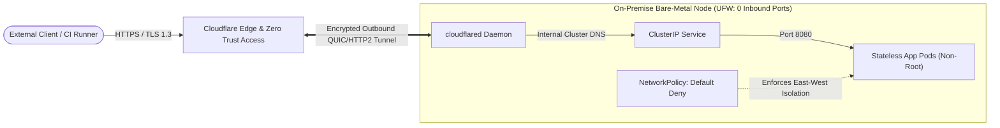

# Zero-Trust On-Premise Infrastructure Blueprint

Production-grade Infrastructure-as-Code (IaC) and GitOps reference architecture for migrating cloud workloads to bare-metal or on-premise Linux nodes without exposing a single inbound public port. Provisioned declaratively via Terraform, orchestrated on hardened lightweight Kubernetes (K3s) or Docker Compose, and isolated behind outbound-only Cloudflare Tunnels and default-deny Kubernetes NetworkPolicies.

---

## Architecture Overview



---

## Key Engineering Design Decisions

- **Zero Inbound Attack Surface:** Host firewall (`ufw`) drops all incoming public traffic (`0.0.0.0/0`). External user traffic and GitHub Actions deployments traverse outbound-initiated `cloudflared` tunnels exclusively.
- **Declarative Edge & Zero Trust Policies:** Tunnel creation, proxied CNAME routing, ingress rules, and Cloudflare Access email policies are version-controlled in `terraform/` with zero manual dashboard drift.
- **Strict East-West Isolation:** Kubernetes `NetworkPolicy` enforces a `default-deny-all` posture inside the `onprem-apps` namespace, permitting ingress to application pods solely from `cloudflared` on port `8080` and blocking lateral movement.
- **Restricted Pod Security:** Workloads run under `pod-security.kubernetes.io/enforce: restricted` with non-root UIDs, read-only root filesystems, dropped Linux capabilities, and disabled service account token automounting.
- **Automated Attack-Surface Verification:** `scripts/verify-zero-ports.sh` audits listening sockets via `ss` during CI/CD deployments to guarantee zero public port exposure.

---

## Repository Structure

```text
zero-trust-onprem-blueprint/
├── .github/
│   └── workflows/
│       ├── terraform-plan.yml      # PR/push IaC formatting, validation & Trivy scan
│       └── deploy-onprem.yml       # Zero-inbound-port deployment via Cloudflare SSH Tunnel
├── terraform/
│   ├── main.tf                     # Cloudflare Tunnel, DNS CNAME & Zero Trust Access Policy
│   ├── variables.tf                # Input variables for domain, account & access control
│   ├── outputs.tf                  # Tunnel ID, CNAME & sensitive tunnel token outputs
│   └── terraform.tfvars.example    # Template variable file
├── k8s/
│   ├── namespace.yaml              # Restricted Pod Security namespace (onprem-apps)
│   ├── network-policy.yaml         # Default-deny ingress/egress & explicit allow rules
│   ├── cloudflared-deployment.yaml # Outbound-only tunnel daemon with readiness probes
│   └── app-deployment.yaml         # Non-root stateless microservice & ClusterIP service
├── scripts/
│   ├── bootstrap-node.sh           # Ubuntu/Debian sysctl + UFW hardening & K3s install
│   └── verify-zero-ports.sh        # Socket audit confirming 0 public open ports
├── docker-compose.yml              # Lightweight single-node alternative to K3s
└── README.md
```

---

## Quick Start

### 1. Provision Tunnel, DNS & Access Policy via Terraform

```bash
cd terraform
cp terraform.tfvars.example terraform.tfvars
# Populate terraform.tfvars and export TF_VAR_cloudflare_api_token="..."

terraform init
terraform plan
terraform apply
```

Retrieve the generated tunnel token for the cluster secret:

```bash
TUNNEL_TOKEN=$(terraform output -raw tunnel_token)
```

### 2. Harden the Bare-Metal Node & Bootstrap K3s

Run on your target Ubuntu/Debian host:

```bash
sudo bash scripts/bootstrap-node.sh
```

> **Note:** To permit SSH strictly from private RFC1918 LAN ranges during initial setup, run `sudo ALLOW_LAN_SSH=true bash scripts/bootstrap-node.sh`.

### 3. Deploy Policies, Tunnel & Workload

Create the Kubernetes secret and apply manifests in dependency order:

```bash
kubectl apply -f k8s/namespace.yaml
kubectl -n onprem-apps create secret generic cloudflared-tunnel-token \
  --from-literal=token="${TUNNEL_TOKEN}"

kubectl apply -f k8s/network-policy.yaml
kubectl apply -f k8s/cloudflared-deployment.yaml
kubectl apply -f k8s/app-deployment.yaml
```

### 4. Verify Zero Open Ports

```bash
bash scripts/verify-zero-ports.sh
```

### Alternative: Single-Node Docker Compose

For smaller edge nodes where K3s is unnecessary:

```bash
export TUNNEL_TOKEN="$(terraform -chdir=terraform output -raw tunnel_token)"
docker compose up -d
bash scripts/verify-zero-ports.sh
```
